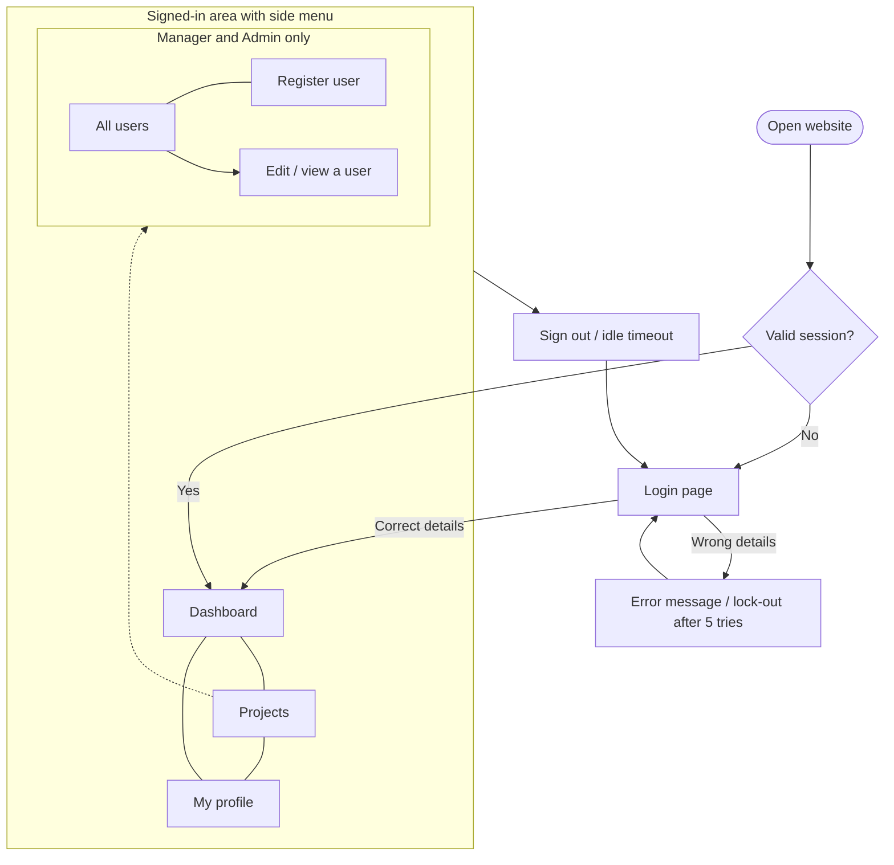
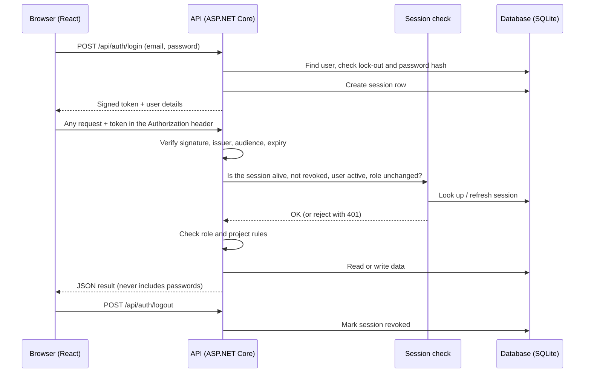
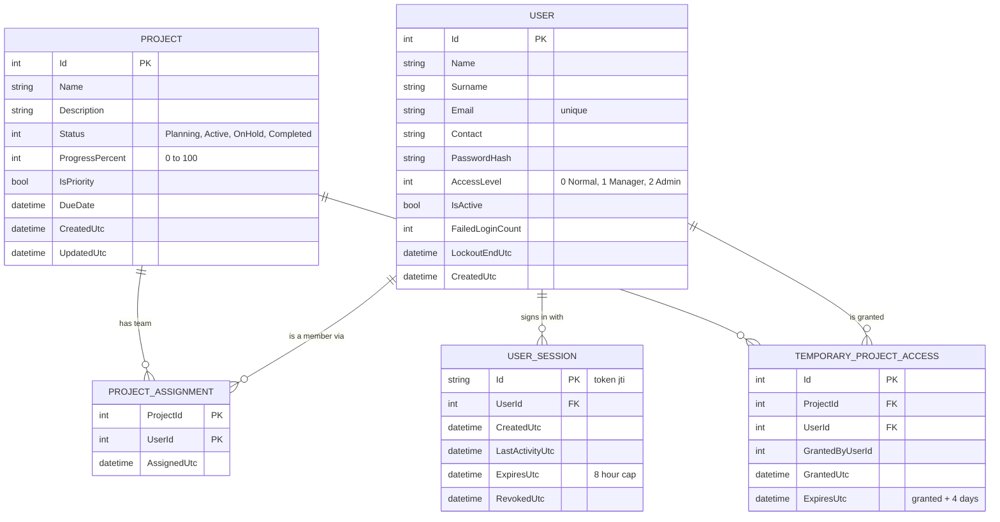

# Resource management system. (RMS)

intro

Ther purpose of this repo was to create a usable product so show off my
design and coding ability as a software developer. For individual
looking to understand the functionality as a user the first 4 categories
(Useful features, Security Features, Functionality & Data structure and
Flow) should be your focus. For a bit more technical breakdown of the
system you can skip to the technical break down section.

Please not the breakdown and the details below and mostly based on the
end product and there will be no build instructions, deployment
instructions or detailed notes on how to make and or run the project locally.
(the details of this file and the project are subject to change as a
result of future updates to the project\*)

# RMS BREAKDOWN

What is a Resource Management System (RMS)

RMS is a web application that helps a team keep track of its projects,
who is working on them, and how far along they are. People sign in, see
the projects they are involved in, update progress, and (depending on
their role) manage projects, team members and user accounts.

It is made of two parts that work together:

### Contents : ---

1. Useful Features

2. Security Features

3. Functionality

4. Data Structure and Flow

5. Technical Aspect

---

## 1. Useful features

Everything a normal user can see or notice while using the program.

- **Clean sign-in page** with clear messages, for example "You were signed out after being inactive" or "Too many attempts, please wait a minute".
- **Role-aware menu.** The side menu only shows the pages you are allowed to use, and it displays your name and role at the top.
- **Dashboard** with at-a-glance numbers:
  - Projects in progress
  - Average progress (%)
  - Overdue projects (highlighted in red when above zero)
  - Completed projects
- **"In progress" list** with a progress bar, status badge and due date for each project. Overdue dates are highlighted. Clicking a project shows its description, team, status, progress, due date and last update.
- **Priority projects** are flagged with a "Priority" tag and always appear at the top of the list.
- **Projects page** where you can open a project, read its details and (if allowed) update the description, status (Planning, Active, On hold, Completed) and progress using a slider.
- **Smart status and progress.** The system keeps the two in step: marking a project Completed sets progress to 100%, reaching 100% marks it Completed, and so on.
- **Team members.** Each project shows who is on the team.
- **Temporary access.** Someone who is not on a project can be given 4 days of access. The project shows a countdown such as "Temporary, 3d 5h left".
- **User directory** (managers and admins) with a search box, role badges and an Active / Deactivated indicator.
- **My profile page** to update your own name, email and contact number, and to change your password.
- **Helpful form hints** such as the password rules and the accepted phone number format, shown right under the field.
- **Confirmation pop-ups** before anything is deleted.
- **Works on phones and tablets.** The side menu collapses behind a menu button on small screens.

---

## 2. Security features

Everything that keeps the program safe, including things you cannot see.

### Signing in

- **Passwords are never stored as text.** Only a scrambled (hashed and salted) version is kept, so even someone with access to the database cannot read them.
- **Strong password rules.** At least 10 characters with an uppercase letter, a lowercase letter, a number and a symbol. A password may not contain the start of the user's own email address.
- **Account lock-out.** After 5 wrong passwords the account is locked for 15 minutes.
- **Brute-force protection.** Each internet address is limited to 10 login attempts per minute.
- **No clues for attackers.** A wrong email and a wrong password give the exact same message, and the system takes the same amount of time to answer in both cases, so nobody can discover which emails exist.
- **Old passwords are upgraded automatically** to the newest hashing format the next time the user signs in.

### Staying signed in

- **Automatic sign-out after 60 minutes of inactivity.**
- **Hard limit of 8 hours** per sign-in, even for someone who is constantly active.
- **Real sign-out.** Clicking "Sign out" cancels the session on the server, so a copied token stops working immediately.
- **Instant effect for account changes.** If an account is deactivated, its role changes or its password is reset by an admin, all the affected sessions stop working straight away.
- **Changing your password signs out your other devices.**
- **Session kept only for the open tab.** Closing the browser tab ends the sign-in.

### Controlling who can do what

- **Locked by default.** Every part of the system requires a logged-in user unless it is specifically opened (only the login page is).
- **Rules are enforced on the server**, not just hidden in the menu. Even if someone types a hidden address or edits the page in their browser, the server still says no.
- **Least privilege.** Normal users only ever see their own projects. Managers cannot touch Admin accounts or other people's passwords.
- **Admin safeguards.** You cannot delete or deactivate your own account, and the system always keeps at least one active admin.
- **Temporary access expires on its own** after 4 days.

### Protecting the data

- **Input checking.** Names, emails, phone numbers, lengths and value ranges are validated before anything is saved.
- **Safe database access.** Queries are built through Entity Framework, which protects against SQL injection.
- **No sensitive data in replies.** The API never sends back passwords or password hashes.
- **Secret key must be set.** The server refuses to start unless a signing key of at least 32 characters is configured.
- **Locked-down browser rules.** Every response carries security headers that block content sniffing, embedding the app in other sites, referrer leaks and caching of private data.
- **Restricted website access (CORS).** Only the configured website address may talk to the API.
- **Secure connections in production.** HTTPS redirection and HSTS are switched on outside of development.
- **Safe error messages.** Users see friendly text, not technical details.
- **Audit log entries** are written when a login is blocked or an account is locked.

---

## 3. Functionality

### How the system works (in plain words)

1. A person opens the website and signs in with their email and password.
2. The server checks the details and, if correct, starts a **session** and hands the browser a signed **token** (like a temporary ID card).
3. Every click after that sends the token along. The server checks the token is genuine, that the session is still alive, and that the person is allowed to do what they asked.
4. Projects and users are stored in a database. The server only returns what that person is allowed to see.
5. On sign-out, inactivity or any security change, the session ends and the person returns to the login page.

### How to use it

1. **Sign in** with your email and password.
2. **Dashboard:** see what is in progress, what is overdue and how you are doing overall. Click a project for details.
3. **Projects:** pick a project from the list. If you may edit it, change the description, status or progress and press **Save changes**.
4. **My profile:** update your details or change your password (you must type your current password first).
5. **Sign out** from the bottom of the side menu when you are done.

Managers and admins also use **All users**, **Register user** and the team / access panels on the Projects page (described below).

### Access levels

Each level has everything from the level before it, then adds more.

#### 1. Basic user (Normal)

- Sign in, sign out and stay signed in while active
- See a **dashboard** that covers only the projects they belong to
- See the **projects** they are assigned to or have temporary access to
- **Edit** those projects: description, status and progress
- View and edit **their own profile** (name, email, contact number)
- **Change their own password**
- _Cannot:_ see other users, create projects, change names or due dates, set priority, or see projects they are not part of

#### 2. Manager

1. **All of the above**, plus:
2. See **every project** and a company-wide dashboard
3. **Create new projects**
4. **Set or remove priority** on any project
5. **Choose the permanent team** for a project
6. **Grant or revoke 4-day temporary access** for Normal users
7. Open the **All users** list and search it
8. **Register new users** (Normal users only)
9. Edit the name, email and contact number of **Normal users and other Managers**

- _Note:_ a Manager edits a project's contents only on projects they are assigned to or have been given temporary access to
- _Cannot:_ touch Admin accounts, change access levels, activate or deactivate accounts, reset passwords, or delete anything

#### 3. Admin

1. **All of the above**, plus:
2. **Edit any project**, including its name and due date
3. **Delete projects**
4. **Create users at any level** (Normal, Manager or Admin)
5. **Change a user's access level**
6. **Activate or deactivate accounts**
7. **Reset another user's password** (this signs that user out everywhere)
8. **Delete users**
9. Edit **Admin accounts**

- _Protected by safeguards:_ cannot delete or deactivate themselves, and the last active admin can never be removed or demoted

---

## 4. Data structure and flow

### Website flow (what the user sees)



### How a request travels through the system



### How the data is stored



---

## 5. Technical aspect

### Repository layout

```
ResourceManagmentsystem/
├── backend/
│   ├── ResourceManagmentsystem.sln
│   └── ResourceManagmentsystem/
│       ├── Program.cs              # startup, auth, rate limiting, headers, pipeline order
│       ├── Controllers/            # Auth (HomeController.cs), User, Project, Dashboard
│       ├── Services/               # PasswordService, TokenProvider, SessionService, ProjectService, ...
│       ├── Models/                 # entities, DTOs, enums
│       ├── Data/                   # AppDbContext, DbSeeder
│       ├── Migrations/             # EF Core migrations
│       ├── appsettings.json
│       └── Dockerfile
└── frontend-redesign/frontend/
    └── src/
        ├── Pages/                  # Login, Dashboard, Projects, Users, UserDetails, AddingUser
        ├── Components/             # Layout, Navbar, ProtectedRoute, ui
        ├── Context/                # AuthContext, AuthProvider, useAuth
        ├── Services/               # ApiClient + Auth/User/Project/Dashboard services
        ├── Types/                  # shared TypeScript types and constants
        └── Utils/                  # date and time helpers
```

### Tech stack

| Layer    | Details                                                                                                   |
| -------- | --------------------------------------------------------------------------------------------------------- |
| API      | ASP.NET Core 8 Web API with controllers, ProblemDetails error format, Swagger UI in development           |
| Data     | Entity Framework Core 8 with SQLite (`app.db`), code-first migrations applied automatically at startup    |
| Auth     | JWT bearer tokens (`Microsoft.AspNetCore.Authentication.JwtBearer`) backed by a server-side session table |
| Hashing  | ASP.NET Identity `PasswordHasher<User>` (salted, with automatic rehash on login)                          |
| Frontend | React 19, React Router 7, TypeScript, Vite 8, ESLint                                                      |

### Backend design

- **Controllers stay thin.** Business rules live in services. `ProjectService` holds every "who can view / edit which project" rule (`CanView`, `CanEdit`, `Map`), so the rules exist in exactly one place.
- **DTOs everywhere.** Entities are never returned directly. `UserDto` has no password fields and `ProjectDto` carries calculated values such as `CanEdit` and `AccessType` (`Full`, `Assigned`, `Temporary`, `ViewOnly`).
- **Dashboard is computed on the server** (`DashboardController`), not in React.
- **Enums.** `AccessLevel` is stored as an integer (0, 1, 2) and sent as a number. `ProjectStatus` is stored as an integer and sent as a string.
- **Dates.** A `UtcConverter` marks every `DateTime` as UTC so JSON ends in `Z` and browsers convert it to local time correctly (SQLite has no real date type).
- **Efficient writes.** Bulk operations use `ExecuteUpdateAsync` / `ExecuteDeleteAsync`; reads use `AsNoTracking` and `AsSplitQuery`.
- **Cascade deletes.** Removing a user or project removes the related assignments, temporary grants and sessions.
- **Unique index** on `Users.Email`, with emails normalised to lower case.

### Authentication pipeline

Order matters in `Program.cs`:

`ExceptionHandler` → Swagger (dev) or HSTS + HTTPS redirect (prod) → security headers → CORS → rate limiter → authentication → authorization → controllers

- **Token validation:** issuer, audience, lifetime (zero clock skew), signature, and `HmacSha256` only (blocks `alg: none` and algorithm swapping). `MapInboundClaims = false` keeps claim names as written (`sub`, `jti`, `role`).
- **Token claims:** `sub` (user id), `jti` (session id), `name`, `email`, `role`, `AccessLevel`.
- **Session check (`OnTokenValidated`):** after the signature passes, `SessionService.ValidateAsync` requires the `jti` session row to exist, belong to the user, be un-revoked, be un-expired and be inside the idle window; the user must still be active and the role claim must match the database. The idle window slides forward, with writes throttled to once per minute.
- **Fallback authorization policy** requires an authenticated user for every endpoint. Role restrictions use `[Authorize(Roles = "...")]` plus finer rules inside actions.
- **Rate limiting:** fixed-window policy `login`, 10 requests per minute per IP, returns HTTP 429.

### API reference

All routes are under `/api` and require a token unless marked public.

| Method | Route                                | Who                               | Purpose                                   |
| ------ | ------------------------------------ | --------------------------------- | ----------------------------------------- |
| POST   | `/auth/login`                        | Public (rate limited)             | Sign in, returns token and user           |
| POST   | `/auth/logout`                       | Any                               | Revoke the current session                |
| GET    | `/auth/me`                           | Any                               | Current user (also used as keep-alive)    |
| GET    | `/dashboard`                         | Any                               | Calculated dashboard data                 |
| GET    | `/project`                           | Any                               | Projects visible to the caller            |
| GET    | `/project/{id}`                      | Any (if allowed to view)          | One project                               |
| POST   | `/project`                           | Manager, Admin                    | Create project                            |
| PUT    | `/project/{id}`                      | Anyone with edit rights           | Update (name and due date are Admin only) |
| DELETE | `/project/{id}`                      | Admin                             | Delete project                            |
| PUT    | `/project/{id}/priority`             | Manager, Admin                    | Set or clear priority                     |
| PUT    | `/project/{id}/members`              | Manager, Admin                    | Replace the permanent team                |
| POST   | `/project/{id}/temp-access`          | Manager, Admin                    | Grant 4-day access to a Normal user       |
| DELETE | `/project/{id}/temp-access/{userId}` | Manager, Admin                    | Revoke temporary access                   |
| GET    | `/user`                              | Manager, Admin                    | List users                                |
| GET    | `/user/{id}`                         | Self, Manager, Admin              | One user                                  |
| POST   | `/user`                              | Manager (Normal only), Admin      | Create user                               |
| PUT    | `/user/{id}`                         | Self, Manager (not Admins), Admin | Update user                               |
| POST   | `/user/me/password`                  | Any                               | Change own password                       |
| DELETE | `/user/{id}`                         | Admin                             | Delete user                               |

### Frontend design

- **`ApiClient.ts` is the only file that calls `fetch()`.** It attaches the bearer token, converts API error bodies into readable messages and signs the user out on any 401.
- **`AuthProvider`** keeps the user in React context, validates a stored token on page load, tracks user activity (mouse, keyboard, scroll, touch), sends a keep-alive (`/auth/me`) at most every 10 minutes while active, and signs out after the idle limit.
- **Token storage:** `sessionStorage`, so it disappears when the tab closes.
- **`ProtectedRoute`** guards pages by login and, optionally, by access level (`STAFF_LEVELS = [Manager, Admin]`). The navbar is driven by a single list that maps each link to the levels allowed to see it.
- **`Types/index.ts`** mirrors the API shapes and holds shared constants such as the phone regex and password hint, so the form hints and server rules stay aligned.

### Configuration

| Setting                                              | Where                                           | Notes                                                              |
| ---------------------------------------------------- | ----------------------------------------------- | ------------------------------------------------------------------ |
| `Jwt:Key`                                            | User secrets or `Jwt__Key` environment variable | **Required**, at least 32 bytes. The app will not start without it |
| `Jwt:Issuer`, `Jwt:Audience`                         | `appsettings.json`                              | Must match between token creation and validation                   |
| `Jwt:IdleTimeoutMinutes`                             | `appsettings.json`                              | Default 60                                                         |
| `Jwt:AbsoluteLifetimeHours`                          | `appsettings.json`                              | Default 8                                                          |
| `ConnectionStrings:Default`                          | `appsettings.json` / environment                | Defaults to `Data Source=app.db`                                   |
| `Seed:AdminEmail`, `Seed:Password`, `Seed:AdminName` | User secrets or environment                     | Used only when no active admin exists                              |
| `Seed:DemoData`                                      | `appsettings.json`                              | `true` creates a demo manager, a demo user and a demo project      |
| `VITE_API_URL`                                       | `frontend/.env.development`                     | Base URL of the API, including `/api`                              |

### Running locally

**Prerequisites:** .NET 8 SDK, Node.js 20 or newer.

**1. Backend**

```bash
cd backend/ResourceManagmentsystem

# set a signing key (random, 64+ characters) and the first admin's credentials
dotnet user-secrets set "Jwt:Key" "<random 64 characters>"
dotnet user-secrets set "Seed:AdminEmail" "admin@rms.local"
dotnet user-secrets set "Seed:Password" "<a strong password that follows the rules>"

dotnet run --launch-profile http     # http://localhost:5204, Swagger at /swagger
```

On first start the database is created and migrated, and the first admin account is created if none exists.

**2. Frontend**

```bash
cd frontend-redesign/frontend
npm install

# point the site at the API (edit .env.development)
# VITE_API_URL=http://localhost:5204/api

npm run dev                          # http://localhost:5173 (port is fixed)
```

**3. Sign in** with the admin email and password you configured. Use **Register user** to create more accounts.

**Other commands:** `npm run build` (type-check and production build), `npm run lint`, `dotnet ef migrations add <Name>` (new migration).
